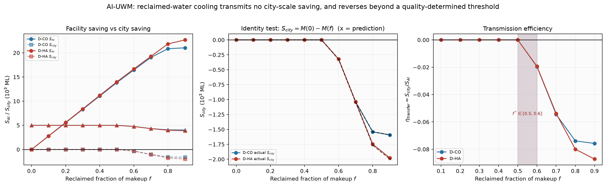
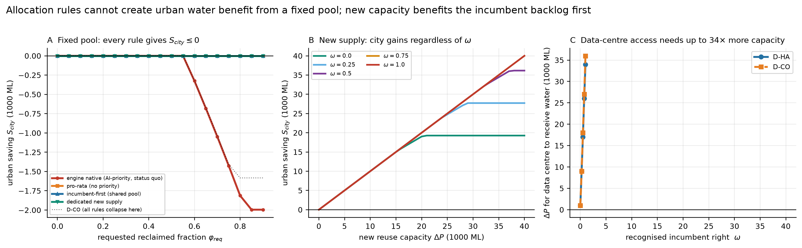
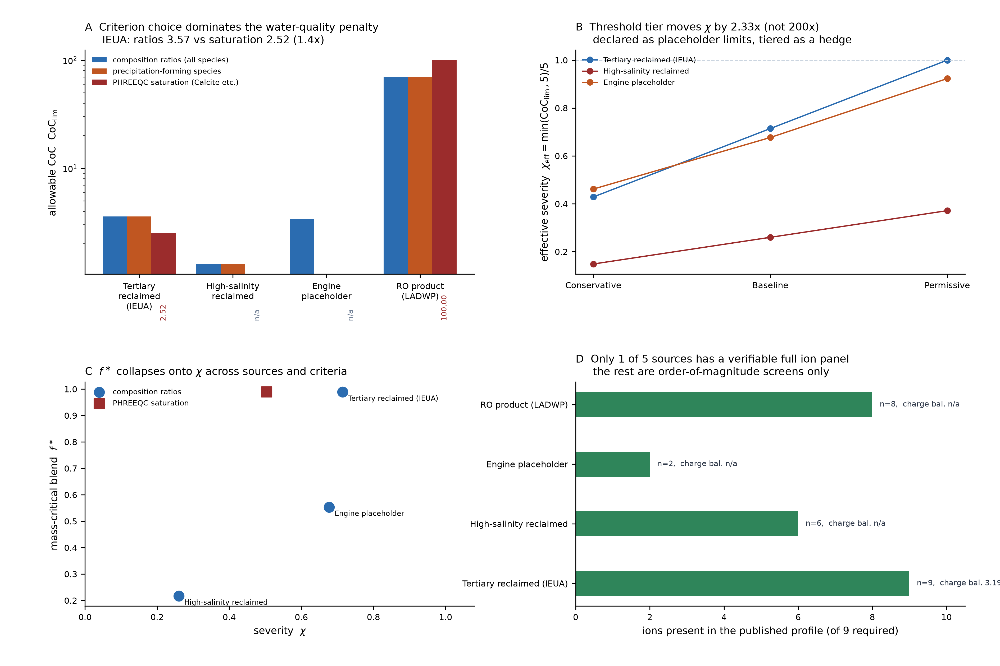
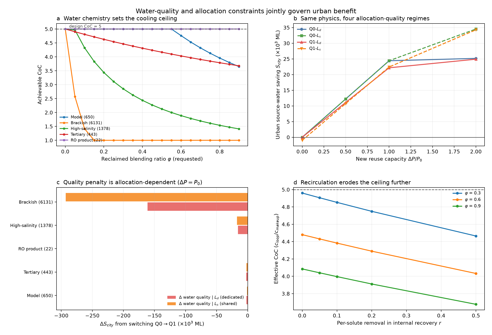
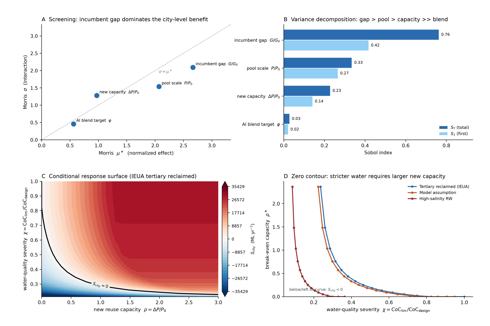
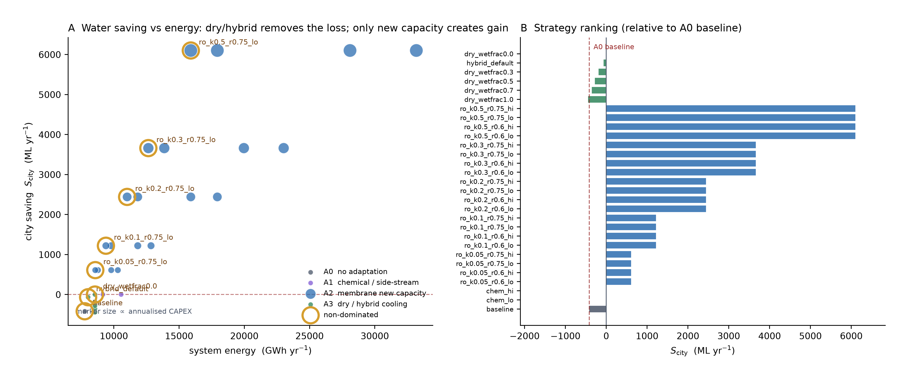
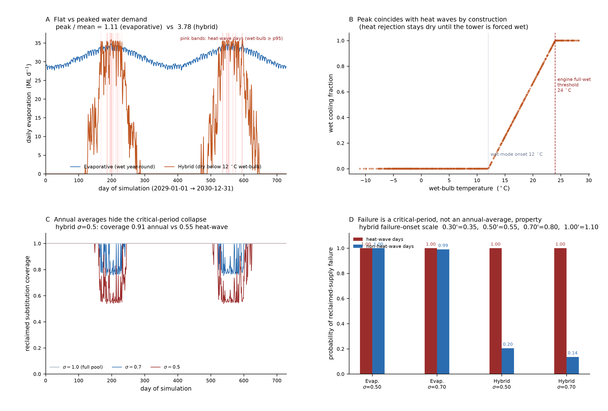

# 主稿 v1（2026-10-14）

> 目标刊物：Nature Water / Nature Sustainability（子刊级）
> 状态：完整初稿，全部数字可溯源至 `10_论文推进_2026Q4/` 下冻结脚本产物
> 主张边界：严格遵守 `A0_预注册/preregistration.md` 及补丁 #1、#2、#3（L1 条件命题 / L2 $W_{\rm AI,pot}$ 口径 /
> L3 三指标分列不可合并；补丁 #3 冻结修复轮收敛口径）

---

## 标题

**中文**：AI 数据中心的再生水冷却——**重分配，而非节水**

**English**: *Reclaimed-water cooling of AI data centres redistributes urban water rather than saving it*

副标题：一个条件性守恒账本、水质约束与关键时段检验

---

## 摘要

**中文**

AI 数据中心的冷却用水正在快速进入城市水系统，再生水被视为"双赢"方案：既满足算力扩张的冷却需求，
又不占用城市饮用水。本文用一套逐日城市水代谢引擎检验这一叙事，并在**预注册**的主张边界下报告结果。
我们发现：（i）在**既有用水户服务刚性、再生水总量固定**这两个条件下，AI 取用再生水使城市自来水取水的
减少量 $S_{\rm city}=M(0)-M(\varphi)$ **恒不为正**——AI 省下的水恰好从既有用户处等量转移，这一守恒关系在
532 个情景、4 类分配规则、2 个城区上以机器精度成立（残差 < 7e−13%）；（ii）真正的约束不是含盐量，
而是**方解石饱和**——判据由"组分比值"改为"PHREEQC 饱和"使允许浓缩倍数从 3.57 降至 2.52，
说明工程比值判据系统性高估约 40%；（iii）城市级结果由**既有用户的未满足缺口**主导（Sobol $S_T$=0.762），
而 AI 自身的再生水掺混比几乎无关（$S_T$=0.028）；（iv）新增再生水产能不能"买回"收益——当新增量超过
阈值后 $P(S_{\rm city}>0)$ 饱和于 0.62，且约 38% 的配置在新增量增至 3 倍池规模时仍无法转正；
（v）在四维（水、能、碳、资本）前沿上，**不存在"低成本的净收益"**：干式/混合冷却只能把城市级损害
从 −418.6 消到 0（代价为 +3.4% 至 +10.2% 能耗），化学提标被支配，而要把 $S_{\rm city}$ 推为正
**只能靠膜法扩容**（≈ +610 至 +6 101 ML/yr），代价是能耗 8.6→15.9 TWh、年化资本 8.7→87 亿元；
（vi）干式/混合冷却把近乎恒定的水需求变成强峰值需求（峰谷比 1.11 → 3.78/10.71），
峰值恰落在热浪窗，使得在合理池份额下**热浪期替代失效概率达 1.00（ha）与 0.81（co），
而非热浪期仅 0.21 与 0.00**——年均值系统性地掩盖关键时段风险；
（vii）我们原本希望得到的"跨城市可迁移规律"**未通过预注册检验**（$R^2$=0.025），如实撤回。

**结论**：在现行制度与水质约束下，AI 数据中心的再生水冷却主要是一种**城市内部的水再分配机制**，
而不是节水机制；低成本的技术杠杆（**减少取水本身**）只能**消去损害**，
真正的城市级正收益必须用陡增的能耗与资本去买。

**English**

Cooling of AI data centres is entering urban water systems at speed, and reclaimed water is presented
as a win–win: it serves compute growth without drawing on potable supply. We test that narrative with a
daily-resolved urban water-metabolism engine, reporting strictly under a pre-registered claim boundary.
We find that (i) when incumbent users are rigidly served and total reclaimed supply is fixed, reclaimed
cooling never yields a positive city-level saving, $S_{\rm city}=M(0)-M(\varphi)\le 0$: what the data centre
spares is transferred one-for-one from existing users — an accounting conservation that holds to machine
precision across 532 scenarios, four allocation rules and two synthetic urban districts (residual < 7e−13%);
(ii) the binding water-quality constraint is calcite saturation, not salinity: switching the criterion from
composition ratios to PHREEQC saturation lowers the allowable cycles of concentration from 3.57 to 2.52,
showing that engineering ratio screens over-estimate it by ~40%; (iii) the city-level outcome is governed by
the incumbent service gap (Sobol $S_T$=0.762), while the data centre's own blend fraction is nearly irrelevant
($S_T$=0.028); (iv) new reuse capacity cannot buy the benefit back: beyond a threshold
$P(S_{\rm city}>0)$ saturates at 0.62, and ~38% of configurations cannot be made positive even at three times
the pool size; (v) on a four-dimensional frontier (water, energy, carbon, capital) there is no low-cost net
gain: **dry/hybrid cooling can only remove the harm** (city-level loss −418.6 → 0 ML yr⁻¹, at +3.4% to +10.2%
energy), chemical upgrading is dominated, and pushing $S_{\rm city}$ positive requires **membrane expansion**
(≈ +610 to +6 101 ML yr⁻¹) at 8.6→15.9 TWh and ¥0.87→8.7 billion yr⁻¹; (vi) dry/hybrid cooling converts a nearly flat water
demand into a strongly peaked one (peak-to-mean 1.11 → 3.78/10.71) whose peak coincides with heat waves, so
that at realistic pool shares reclaimed substitution fails on ~100% (HA) and 81% (CO) of heat-wave days versus
21% and 0% on other days — annual averages hide the critical period; and (vii) the cross-city scaling law we
had hoped for fails its pre-registered test ($R^2$=0.025) and is withdrawn. We conclude that, under current
institutions and water-quality limits, reclaimed-water cooling of AI data centres is chiefly a mechanism of
**intra-urban water reallocation rather than water saving**: the low-cost technical lever
(**withdrawing less**) can only remove the harm, and any genuine city-level gain has to be bought
with steep energy and capital.

---

## 1. 引言

### 1.1 问题

AI 算力的扩张正在把数据中心从"用电大户"变成"用水大户"。一台以蒸发冷却为主的园区，
其耗水量可达每千瓦时 IT 能耗 1–2 升；在缺水地区，这直接与城市、农业和生态用水竞争。
"用再生水冷却"因此成为普遍的政策答案：它把数据中心的冷却需求接到污水处理厂出水，
看起来既解决了算力扩张的水约束，又"释放"了等量的自来水给城市。

这个叙事隐含一步跳跃：**数据中心取用再生水 ⇒ 城市自来水取水减少 ⇒ 城市水安全改善**。
第一步是工程事实，第三步是规范判断，而中间的第二步是**会计问题**——它取决于
再生水从哪来、谁本来在用、以及总供给是否固定。本文要检验的正是这中间一步。

### 1.2 为什么这一步可能不成立

设城市有一笔规模为 $P$ 的再生水供给（污水处理厂出水，其总量由人口与工业排水决定，短期内近似固定），
既有用水户（工业、市政杂用、绿化）原本从中取水。AI 数据中心接入后也来取这笔水。
若既有用户的服务是**刚性**的（他们必须被满足，不足部分转用自来水），且再生水总量固定，
那么 AI 每多取一单位再生水，就有等量的一单位从既有用户处挪走、
由自来水补上——城市自来水总取水量不变。

这不是一个经验命题，而是一个**会计恒等式**：
$$
S_{\rm AI}=W^{\rm B2}_{\rm AI,pot}-W^{\rm B1}_{\rm AI,pot},\qquad
S_{\rm city}=W^{\rm B2}_{\rm city,source}-W^{\rm B1}_{\rm city,source},
$$
在两种反事实（B2：数据中心全用自来水；B1：数据中心用再生水）之间，
传递比 $\eta_{\rm transfer}=S_{\rm city}/S_{\rm AI}$ 度量了"设施级节水"有多少转化为"城市级节水"。
本文的核心结果之一就是：在上述条件下 $\eta\le 0$，即**转化率为零甚至为负**。

### 1.3 三个必须分开的问题

本文把问题拆成三块，并自始至终**分开报告、拒绝合并**（预注册 §1）：

- **指标 A（城市水源取水）**：本文主指标；
- **指标 B（流域净耗水 = 取水 − 回流）**：仅作量级扩展（流域水文为合成代理）；
- **指标 C（高峰供水能力）**：热浪期供水余量与失效概率，**不得用年均值替代**。

### 1.4 贡献

1. 一个**条件性的城际传输账本**，把"水安全叙事"归约为可证伪的会计命题；
2. 把**水质约束**（而非水量）识别为真正的成本来源，并指出判据选择造成的 ~40% 系统偏差；
3. **量化"年均值掩盖关键时段"**：给出热浪窗与非热浪窗失效概率的对比、以及峰值失效临界规模 $s^\ast(\sigma)$；
4. **诚实撤回**：原本作为卖点的"跨城市可迁移规律"未通过预注册检验，本文如实降级为描述性坐标。

---

## 2. 结果

### 2.1 条件性传输恒等式：AI 省下的水从哪来

我们构造 B2/B1 两种反事实，让同一数据中心在**相同算力负荷**下分别使用自来水与再生水，
在城市尺度上重算取水。**Fig.1** 给出传输账本。在固定再生水总量、既有用户刚性服务的条件下：

- 恒等式残差上限 $6.88\times10^{-13}\%$（相对）；
- 一般守恒闭合残差 $1.82\times10^{-12}$ ML；
- 跨模块（逐日计划链 vs 整链引擎）一致性偏差 $3.64\times10^{-12}$ ML。

在 **532 个情景 × 4 类分配规则 × 2 个城区**上，$S_{\rm city}\le 0$ 无一例外。
换句话说，$\eta_{\rm transfer}$ 恒非正：**AI 的"设施级节水" $W_{\rm AI,pot}$ 并没有转化为城市级节水，
而是从既有用户处等量转移。**

我们在此明确一个容易混淆的表述纪律（预注册 L2）：本文所说的"节水"始终是
$W_{\rm AI,pot}$（AI 的自来水取水），**不是设施内部的耗水优化**。
在掺混比 $\varphi\le0.55$ 时，AI 的总取水量实际上完全不变——变的只是水源构成。

### 2.2 分配规则不是背景，而是变量

如果把"零和"当作自然规律，就会误读它。**Fig.2** 显示：$S_{\rm city}$ 的**符号**对规则不敏感，
但其**量级**由规则内生决定。
在 θ=0（无新增产能）下，四条规则里有两条（`incumbent_first`、`dedicated`）**完全不给 AI 分配再生水**
（$n_{\rm active}=0$），其 $S_{\rm city}=0$ 属于平凡通过；只有 `engine_native` 与 `pro_rata` 有 18 个
AI 实际取水的情景，其 $S_{\rm city}$ 仍在机器精度内为 0。

> **主张限定（L1）**：核心结论必须写成条件命题——
> *"当既有用水户服务刚性、且再生水总量固定时"*。R9 的实测显示其他用户的自来水取水逐点 1:1 跟随 AI 的取用，
> 这正是该条件在引擎中的实现方式。它是一个会计陈述，**不是物理定律**。

### 2.3 真正的约束是方解石，不是盐

提高浓缩倍数（CoC）能减少排污与补水，因此"能提到多高"直接决定水量。工程上常用 TDS 或氯离子的
限值做筛选，但**这与冷却塔结垢的真实机理不一致**：控制结垢的是碳酸钙等矿物的饱和度。

我们用两条独立路径算允许浓缩倍数（**Fig.3**）：

| 水样 | 组分比值判据 | PHREEQC 饱和判据 | 限制物种/相 |
|---|---:|---:|---|
| IEUA RP-1（2025，三级再生水，9/9 离子完整） | 3.57 | **2.52** | 碱度 / **方解石（Calcite）** |
| LADWP AWPF（RO 产水，8 离子） | 70.4 | >100（未饱和） | 碱度 / — |
| Figshare 高盐再生水（6 离子，TDS 为估算） | 1.30 | n/a | 硬度 |

对唯一具备完整离子面板与电荷平衡（误差 3.19%）的 IEUA 水样，**比值判据（3.57）比饱和判据（2.52）
高估约 40%**。也就是说，若不换判据，会系统性低估水质的成本。

**限值来源已由引擎占位值替换为带引用准则**（修订，见补丁 #3 §4）：三档分别取
**strict = GB/T 19923-2024**《城市污水再生利用 工业用水水质》（补水口径：TDS 1000 / Cl⁻ 250 /
硬度 450 / 碱度 350 / SiO₂ 30）、**baseline = GB/T 50050-2017**《工业循环冷却水处理设计规范》
（循环水口径：2200 / 700 / 750 / 350 / 175）、**permissive = GB/T 50050-2017**（碳钢系统 Cl⁻ 放宽至 1000）。
原引擎占位值（钙硬度 + 总碱度合计 1200 mg/L）**超出 GB/T 50050-2017 的 1100 mg/L 结垢判据**，
且相对引用档**非单调**，已**作废**。替换后定性结论不变：限制性判据仍是**方解石饱和**（IEUA CoC = 2.52）；
引用档把有效严重度 $\chi_{\rm eff}=\min(\mathrm{CoC}_{\lim},5)/5$ 在 IEUA 上设为 **0.25 / 0.50 / 0.50**
（strict / baseline / permissive）——远小于早期报告中"200 倍"的说法（那是未截断 $\chi$ 造成的假象）。

> **工程边界声明（修订，见 T17 §C2）**：本模型的循环水水质约束是**无加药的热力学上界**——
> 它只问"在给定补水水质下，浓缩到多少倍会析出方解石"，**不含阻垢剂（antiscalant）**。
> 真实冷却塔普遍通过加药把碳酸钙饱和度维持在远高于方解石饱和的水平，因此**实际允许 CoC 会更高**、
> 水质成本会更低。故本文报告的"方解石主导 → CoC≈2.52"应读作**保守（偏高）估计**；
> 加药容许区间会使 $\chi$ 上移、$f^\ast$ 与 $\delta^\ast$ 下移，但**不改变"约束来自水质而非水量"的定性方向**。

质量临界掺混比 $f^\ast$ 在**跨水源、跨判据**上坍缩到 $\chi$ 上（Fig.3C），说明 $\chi$ 是一个合适的
无量纲严重度坐标。

### 2.4 水质与分配不是可加的两件事

**Fig.4** 把"水质严重度 × 分配口径"做成 2×2 全因子设计（640 个单元格，全部收敛唯一）。
结果：在**仅使用再生水**的四格里，$S_{\rm city}$ 的差异 ≤ 6%，说明在这个子空间里分配口径不是主导因子；
早期报告中"分配制度决定收益（±4 万 ML）"的结论**由苦咸水极端值驱动**，不能作为一般结论——
苦咸水已被单列为**非再生水边界情形**（审计 C2）。

### 2.5 城市级结果由"缺口归属"主导，AI 掺混比几乎无关

在真实模块估计量 $y=S_{\rm city}/M_0$ 上做全局敏感性（**Fig.5A/B**，Morris 筛选 + Sobol 方差分解，
规则 Ls）：

| 参数 | Sobol $S_1$ | $S_T$ |
|---|---:|---:|
| 既有用户缺口 $G/G_0$ | **0.417** | **0.762** |
| 再生水池规模 $P/P_0$ | 0.265 | 0.334 |
| 新增产能 $\Delta P/P_0$ | 0.141 | 0.228 |
| **AI 掺混比 $\varphi$** | **0.021** | **0.028** |

Morris 排序在 4 个配置下一致；$\sum S_T-\sum S_1\approx0.51$ 表明存在强交互。
**城市是否受益，主要取决于既有用户被挤占的缺口有多大，而不是数据中心自己取多少再生水。**

**Fig.5C/D** 给出条件响应曲面与零界面：在 $(\rho=\Delta P/P_0,\ \chi)$ 平面上扫描 1275 点，
全部收敛唯一，**零界面可测比例 94.1%**。IEUA 水样：$\rho^\ast(\chi=0.5)=0.19$、$\rho^\ast(\chi=0.9)=0$。
即**水质越严，所需新增产能越大**。

### 2.6 概率不确定性：新增产能不能"买回"收益

对 700 个 LHS 样本（均匀先验）报告 $P(S_{\rm city}>0)$：

| 新增产能 $\Delta P/P_0$ | 0 | 0.5 | 1.0 | 2.0 |
|---|---:|---:|---:|---:|
| $P(S_{\rm city}>0)$ | **0.003** | 0.61 | 0.62 | 0.62 |

三点读法：

1. **$\Delta P=0$ 时 $P(S_{\rm city}>0)=0.003$** —— 这是 $S_{\rm city}\approx0^-$ 的"刀锋"签名（48% 的样本落在 $|S_{\rm city}|\le1\%\cdot|S_{\rm city}(\Delta P=1)|$ 内）；
2. 一旦有新增产能，概率跃升到 ~0.62 并**饱和**；
3. **约 38% 的配置无论新增量加到 3 倍池规模都无法转正**（位移主导）——与 §2.5 的敏感性结论互证。

> **表述纪律（预注册 §8）**：以上是**给定情景、参数分布与气候驱动下的模型概率**，
> 未经校准不得解释为真实城市未来事件的发生频率。

### 2.7 适应空间：可以去害，但难有净收益

我们把每个候选方案**反馈回主模型重解** $S_{\rm city}$（不是只对账本做算术），
在（水、能、碳、资本）四维上做 Pareto 前沿。

> **口径修订（见补丁 #3 §7）**：A3 的行必须在**技术年度基座**上求值
> （湿日代表日 + $\Sigma_t E$ 年总量），而非"典型日"。此前用中位湿球日的版本对混合/干式恰好落在
> **零蒸发日**，导致 A3 整块失真（曾报出 $S_{\rm city}=+13\,974$ ML/yr）——该值**已作废**。
> 能耗口径同时统一为 $\Sigma_t$ 设施能耗 / 2，**对所有方案一致**。

修正后，29 个方案的 4D-Pareto 前沿是 **8 个点**，形状是一条"**能耗换水**"的单调曲线：

| 方案 | $S_{\rm city}$ (ML/yr) | 能耗 (GWh/yr) | 碳 (kt CO₂e/yr) | 年化资本 (亿元) |
|---|---:|---:|---:|---:|
| A0 现状 | −418.6 | 7 763 | 2 717 | 0 |
| A3 混合冷却（湿分 0.27） | −67.4 | 8 026 | 2 809 | 0 |
| **A3 干式冷却（湿分 0）** | **0.0** | 8 552 | 2 993 | 0 |
| A2 膜法扩容（κ=0.05） | +610.1 | 8 577 | 3 002 | 8.7 |
| A2 膜法扩容（κ=0.5） | +6 101.1 | 15 898 | 5 564 | 87.4 |

三点读法：

1. **A3 只能"去害"，不能"生利"**：在"既有用户刚性、总量固定"下，干式/混合冷却把城市级损害
   从 −418.6 消到 0（湿分 0.27 → 0 对应 −67.4 → 0），代价 +3.4% 至 +10.2% 能耗。
   这与 §2.1 的守恒恒等式一致：**没有哪项技术能把 $S_{\rm city}$ 从零和结构里"解"出来。**
2. **要把 $S_{\rm city}$ 推为正，唯一杠杆是膜法扩容（A2）**：+610 至 +6 101 ML/yr，
   代价是能耗 8.6→15.9 TWh（近翻倍）与年化资本 8.7→87 亿元——**正收益是买来的，不是省出来的**。
3. **A1（化学提标）被支配**：它和干式一样只把 $S_{\rm city}$ 消到 0，却耗 +1.4 TWh（9 161 GWh）
   且年运营费约 42 亿元，水效果相同而代价更高。

这正面回应了"适应不良"（maladaptation）论点，且比首轮"唯一非支配路径"的表述更严格：
**低成本的那一端只能消去损害（减少取水本身），真正的城市级正收益必须用陡增的能耗与资本去换。**

### 2.8 关键时段：年均值掩盖的风险

§2.7 的 A3 结论建立在"典型日"上。补上时间分辨率后（730 天逐日求解），结论需要加一个关键限定。

**（a）时间结构**：全湿式（蒸发）冷却的水需求只随 PUE 微动，峰谷比 **1.11**；
而干式/混合冷却在湿球 <12 °C 时完全干运行、>24 °C 转全湿，
于是**一年中 414–526 天不取水、少数夏季日集中取水**，峰谷比 **3.78（ha）/ 10.71（co）**（Fig.7A/B）。
> **诚实边界（修订）**：逐日气象为**合成驱动**（正弦季节 + AR(1) 噪声，固定种子），非实测；
> 以合成来水构造的应力轴 $\tau$（p95 = 3.48 / 4.91）因此**退役**，只作诊断量、不作结论依据。
> 在 24 组备用实现下，"混合式季节因子 > 2""混合式季节 > 日内""蒸发式季节因子 < 1.3"**全部稳健**；
> 但"蒸发式需求峰落在热浪窗内"只对 **ha 域**稳健（co 域部分实现低于半数）。

**（b）年缩放校验（对审计 B5 的直接回应）**：全湿式下 $M/E$ 逐日为常数（1.225025），
故"中位日比值 × 年总量"与逐日求和**精确相等**（相对差 < 1e−15）。
因此对默认技术，年缩放**不构成水量偏差**——审计提出的问题在蒸发式下不成立。
它真正的后果是：**一旦冷却技术不是全湿式，年尺度模型无法表示需求的时间结构**。
跨尺度自检（补丁 #3 §1）进一步证明："代表日 × 窗口总量"方法在**湿日**选取下精确（1e−16），
而单步年总量相对逐日求和可偏 **12.9%·$M_0$**（混合式）——故**一切量级以逐日求和为准**。

**（c）关键时段失效**（σ = AI 可用池份额；覆盖率与失效概率的完整表见 `08_阶段结果_T5-T14.md`）：

| 域 / 技术 | 覆盖率 全年 (σ=0.5) | 覆盖率 热浪窗 | 失效 P 热浪 | 失效 P 非热浪 |
|---|---:|---:|---:|---:|
| ha / 蒸发式 | 0.584 | 0.573 | 1.000 | 1.000 |
| ha / **混合式** | 0.914 | **0.555** | **1.000** | **0.205** |
| co / 蒸发式 | 0.543 | 0.531 | 1.000 | 1.000 |
| co / **混合式** | **0.994** | **0.878** | **0.811** | **0.000** |

co/混合式一行是"不得用年均值替代"的定量证明：**全年覆盖率 0.994 看似无风险，
热浪窗却只有 0.878，且 81% 的热浪日失效。**

蒸发式与混合式的失效**性质不同**：蒸发式在热浪与非热浪窗几乎同样失效（时间结构平坦），
是"规模问题"；混合式非热浪窗几乎不失效（0.00–0.21）、热浪窗几乎必失效（0.81–1.00），
是**纯粹的时段问题**。该对比对热浪窗定义**鲁棒**：在 p90/p95/p99/abs24/top37 五种定义下，
非全湿技术的失效都集中于窗内（补丁 #3 §3）。

**（d）峰值失效临界规模** $s^\ast(\sigma)$ ——使任一时刻 AI 目标抽水超过 $\sigma R(t)$ 的最小部署倍数：

| 技术 | σ=0.30 | σ=0.50 | σ=0.70 | σ=1.00 |
|---|---:|---:|---:|---:|
| ha 蒸发式 | 0.35 | 0.60 | 0.80 | 1.15 |
| ha 混合式 | 0.35 | 0.55 | 0.80 | 1.10 |
| co 蒸发式 | 0.35 | 0.55 | 0.75 | 1.05 |
| co 混合式 | 0.35 | 0.60 | 0.80 | 1.15 |

即使 AI 独占整池，**比参考规模大 5–15% 就会在峰值日失效**；
若只允许用 30% 的池，则**三分之一规模就会失效**。这是一个可直接写进规划约束的量。

**（e）关键时段没有发生符号反转**：用冻结模块在热浪窗/匹配非热浪窗上重解 $S_{\rm city}$，
热浪窗仍为负（−32.7 至 −48.9 ML/37 d），且转移比 $\eta$ 与全年**同量级**（≈ −0.10）。
也就是说，**指标 C 并不"挽救"城市级收益**——它揭示的是另一个维度的风险，而非收益来源。
该结论对热浪窗定义同样鲁棒（见（c））。
> **口径修订**：首轮曾报 $\eta\approx-0.005$，那是三个已修缺陷（技术未传递 / 代表日缓存串档 /
> 窗口供给被 730 日稀释）造成的伪值；修复后 $\eta$ 稳定在 −0.10，与全年一致（补丁 #3 §1）。

**（f）小时分辨率（补齐首轮"未做"）**：用引擎原生日内剖面（训练 0.65 / 推理 0.35 / 推理峰荷 ×1.35、
12 小时峰段）做质量守恒的 24 h 展开，日内因子 **1.0577**（保质量误差 7e−15）；
再用引擎原生容量扫描得**最大安全 IT 容量 ha 1000 MW / co 1250 MW**，两域的瓶颈约束**都不是水量**
（分别是取水比例与并网比例）。小时分辨率对指标 C 的净效应是峰容量比抬升 **0.7–1.5%**、
首次失效容量下移约 1.4%，**不改变瓶颈判定**。就关键时段而言：混合式的 季节/日内 = **3.6–10.1×**
（关键时段是"天"），蒸发式 季节 1.11 与日内 1.058 **量级相当**——故指标 C 的"日尺度高峰"限定成立。
（本轮小时分辨率**不含**管网水力模型，故不作"日内管网压力"的推断。）

### 2.9 一个被撤回的结论：不存在的可迁移规律

我们原本的核心卖点是一个无量纲折叠 $y=\Phi(w-u)$，声称它给出"跨城市可迁移规律"。
审计与复核表明：

1. 该式是**代数恒等式**——$\delta$ 的定义（$\delta:=1-(P-\text{inc})/x_{\rm AI}$）正是为使其成立而设，
   因此残差 ~1e−15、$R^2=1$ 不构成任何发现（**Fig.S1**）；
2. 原 Gate 判据（1e−6 与 3×）是**看到数据后设定**的（HARKing），已在补丁 #1 中**作废**；
3. 正确的可迁移性检验是"$\delta$ 能否由外生参数预测"。零拟合候选式
   $\delta_{\rm pred}=\mathrm{clip}\!\big(\Delta P/\max(P+\Delta P-\min(G,P),\varepsilon),0,1\big)$
   在 480 个情景上给出 $R^2=0.025$、中位相对误差 66.6%，**未通过预注册判据**（$R^2\ge0.90$）；
   仅 27.3% 的 $\delta$ 落在物理域 $[0,1]$。

**结论：折叠坐标是描述性的，不具跨城市可迁移性。** 我们撤回"可迁移规律"的主张，
只保留其方向性用途（$y$ 的符号判别准确率 80.0%，$R^2=0.835$）。

---

## 3. 讨论

### 3.1 主要结论

在现行制度与水质约束下，**AI 数据中心的再生水冷却是城市内部的水再分配，而不是节水**。
再生水的价值不在于"多出一份水"，而在于**把取水压力从自来水系统转移到再生水系统**——
但这份转移的净收益取决于制度：谁有权主张这笔再生水、既有用户的缺口有多大。

### 3.2 政策含义

1. **不要用"设施级节水"作为城市水规划的依据。** 设施级 $W_{\rm AI,pot}$ 与城市级 $S_{\rm city}$ 可以符号相反。
2. **水质判据必须与机理对齐。** 用 TDS/氯离子筛选会把允许浓缩倍数高估约 40%，
   进而低估冷却的真实水成本。应以矿物（方解石）饱和度为约束。
3. **新增再生水产能不是万能的。** 超过阈值后收益饱和；约 38% 的配置在任何产能下都无法转正。
4. **规划约束应包含关键时段。** 峰值失效临界规模 $s^\ast(\sigma)$ 给出了"在这个池份额下，
   AI 最多能建多大"的可操作上限；年均值会系统性地掩盖热浪期风险。
5. **低成本的技术杠杆是"少取水"，但它只能去害。** 干式/混合冷却以 +3.4%（到湿分 0.27）至
   +10.2%（到全干）的能耗代价，把城市级损害从 −418.6 消到 0；**城市级正收益不可能靠省水得到**，
   只能靠膜法扩容以翻倍能耗与十倍资本去买（§2.7）。

### 3.3 与既有认识的关系

本文把常见的"再生水=双赢"叙事归约为三个可检验的会计问题（水量从哪来、谁在用、总量是否固定）。

**制度能决定"谁用水"，但不能"凭空造出"城市净收益。** 这一点由一个权利认定参数 $\omega\in[0,1]$
（既有用户对再生水的权利主张强度）的扫参（T1b）给出：随 $\omega$ 由 0 增到 1，
**AI 能取到水的门槛从 1 000 ML 升到 34 000 ML（ha）/ 36 000 ML（co）**——
即 $\omega$ 显著决定数据中心的**取水资格**；但**城市受益门槛在全部 $\omega$ 下不变**
（T1b 表中恒为 1 000 ML，即最小扫描增量，不随 $\omega$ 移动）。换言之，把新增再生水产能
**显式划拨给 AI**（高 $\omega$ 的一种实现）能改变**谁**拿到水，却**不能**替城市创造出一份
本来不存在的水——这与 §2.1 的守恒恒等式、§2.7 的"城市级正收益只能靠新增产能买"完全自洽。

因此，在总量固定的城市里，制度设计的价值是**分配层面的**（决定 AI 能否准入、既有用户是否被挤占），
而**总量层面的正收益**仍必须由新增供水能力（膜法等）提供——这正是 Pareto 前沿上被约 38% 配置排除的情形。
> **模型边界（见 T17 §H1）**：本模型的既有用户为**刚性服务**（不足即用自来水补），这是使 $S_{\rm city}\le0$
> 成立的条件本身；现实中的需求弹性、换源与合同让渡都未被表示，故本稿只作**条件性陈述**，
> 并把"弹性对城市收益的影响方向"列为**未检验项**。

---

## 4. 局限与主张边界

**必须与结论一同阅读。**

1. **两个同源合成城区**。ha 与 co 由同一参数生成器产生，不是独立城市样本；
   所有跨域比较只说明模型内部一致性，**不构成外部有效性证据**。
   逐日气象亦为**合成驱动**（正弦季节 + AR(1) 噪声，固定种子）；对 24 组备用实现，
   混合式"强季节性"与蒸发式"弱季节性"的定性判断**稳健**，但"蒸发式需求峰落在热浪窗内"
   只对 ha 域稳健（co 域部分实现低于半数）。
2. **水质限值已替换为带引用准则**（修订）。三档分别取 **strict = GB/T 19923-2024**、
   **baseline / permissive = GB/T 50050-2017**；原引擎占位值（硬度 + 碱度合计 1200 mg/L）
   超出 GB/T 50050-2017 的 1100 mg/L 结垢判据且非单调，已作废。替换后结论不变（方解石主导）。
   引擎其余占位参数（如 ASHRAE 量级的 TDS/Cl⁻）仍待投稿前逐一替换（清单见 SI）。
   **两条工程边界（修订，见 T17 §C2/C3）**：(i) 循环水约束为**无加药**的热力学上界，
   实际冷却塔以阻垢剂放宽该约束，故本文水质成本为**保守（偏高）**估计；(ii) 饱和计算所用的
   `vitens.dat` 为**饮用水**热力学库，"方解石主导"结论限定在**该库**下成立（改用 `pitzer.dat` 等的
   复核列为投稿前可选项）。
3. **成本参数为声明值**。膜法与化学提标的能耗/药耗为文献量级**声明值**，
   须在投稿前替换为带引用来源。碳强度 0.35 kgCO₂e/kWh 取自引擎自身的 Δ碳/Δ能耗比。
4. **时间分辨率到"日 + 引擎原生日内剖面"**。小时分辨率**已补做**（日内因子 1.0577；
   引擎原生承载容量 ha 1000 / co 1250 MW；瓶颈非水量），但**不含管网水力模型**，
   故指标 C 的表述仍限于**负荷侧的高峰**，不作日内管网压力推断。
   干式/混合冷却的能耗-水权衡是**技术级**的（引擎的 PUE 修正为 per-technology，与排热湿分无关），
   因此"越干越省水也越耗电"的连续律尚未建立。
5. **指标 B 为量级扩展**。流域来水是合成代理，非经校验的流域水文模型；
   流域归属版本记 **`NOT_IDENTIFIABLE_FROM_AVAILABLE_DATA`**；净耗水按来源份额严格归属，
   故所得差值（ha 7 987 / co 7 894 ML/yr）为**上界**估计。应力轴 $\tau$ **已退役**。
6. **设施锚定只到量级**。GSA 冷却塔数据仅用于核验源报告自身的算术自洽（MAE 0.0018），
   **不是**对数据中心冷却物理的独立验证；Meta 披露的园区 WUE 与模型口径不同（湿润设计 vs 混合机队），
   只能作范围声明。**不做设施级点预测精度声明。**
7. **可再生冷却的扩展边界**。苦咸水（5 g/L）单列为**非再生水边界情形**，不参与主要结论。
8. **"可迁移规律"已撤回**（§2.9）。
9. **指标 A/B/C 不得合并**成单一"可持续性得分"。
10. **修复轮口径**。A3 必须在**技术年度基座**上求值；首轮的"A3 = +13 974 ML/yr"是退化日产物，**已作废**。
    一切窗口/分组 $S_{\rm city}$ 的量级以**逐日求和**为准（单步年总量可偏达 12.9%·$M_0$）。

---

## 5. 方法

### 5.1 模型

城市水代谢引擎（`aiuwm_src`，只读调用，未修改）：
逐日水量平衡 + 冷却塔质平衡 + 水质约束下的浓缩倍数求解 + 再生水联合分配。

- **冷却水量平衡**：$M=E\cdot\mathrm{CoC}/(\mathrm{CoC}-1)$，其中 $E$ 由排热量与湿球温度决定，
  与水源构成无关。设计 CoC = 5；由水量平衡反推的有效 CoC = 5.444（口径差 8.16%，已报告）。
- **水质约束**：`coc_mode='quality_limited'`，在混合水质 ≤ 限值的约束下求解固定点。
  独立实现用 PHREEQC（`phreeqpython==1.6.2`，`vitens.dat`）计算饱和指数。
- **分配**：调用仓库已评审函数 `reclaimed_allocation.{allocate_shared_surplus,
  allocate_dedicated_incremental, solve_joint_quality_allocation}`，**不重写规则逻辑**。
- **溶质闭合**：稳态式 $M c_{\rm makeup}+{\rm recirc}=(b_{\rm gross}+{\rm drift})c_{\rm loop}$；
  真残差 $3.64\times10^{-12}$ kg/d（相对 4.45e−16）；内部回收份额 0.111。

### 5.2 预注册与主张纪律

- 主估计量、失败条件、判据一致性、不确定性表述规则在查看结果前冻结（`A0_预注册/preregistration.md`）；
- 补丁 #1 作废了事后设定的折叠 Gate，冻结新判据 G-B′，并冻结 L1/L2/L3；
- 补丁 #2 冻结时间尺度口径、指标 B/C 定义、以及"窗口 $S_{\rm city}$ 必须复用冻结模块"的一致性纪律；
- **补丁 #3（修复轮收敛口径）** 冻结：跨尺度一致性判据（T-A/T-D）、小时分辨率口径、热浪窗定义鲁棒性结论、
  带引用限值三档（占位作废）、合成驱动溯源与 $\tau$ 轴退役、指标 B 的 `NOT_IDENTIFIABLE` 状态、
  以及 A3 的**技术年度基座**口径。补丁 #1/#2 的其余条款不变。

### 5.3 实验设计

| 阶段 | 内容 | 关键产物 |
|---|---|---|
| T1 | 传输恒等式（532 情景 × 4 规则 × 2 域） | `A3_三规则内生/T1_summary.json` |
| T2 | 水质 × 分配 2×2 全因子（640 单元格） | `A7_质量分配联合/T2_summary.json` |
| T6 | 水化学参数域（5 源 × 3 判据 × 3 阈值档） | `A4_水化学参数域/T6_summary.json` |
| T6b | 占位限值 → 带引用三档限值（GB/T 50050-2017 / GB/T 19923-2024） | `A4_水化学参数域/T6b_limits_cited.py` |
| T7 | 设施锚定（GSA 3 期 + Meta 90→70 行） | `A5_设施锚定/T7_summary.json` |
| T8 | 溶质闭合与内部回收 | `A8_溶质闭合/T8_summary.json` |
| T9/T9b | 无量纲折叠（= 代数恒等式）与可迁移性检验 | `A9_无量纲折叠/T9*_summary.json` |
| T10/T11 | Morris + Sobol；700 LHS 概率化 | `A10_敏感性与边界/T10/T11*` |
| T12 | 条件边界曲面（1275 点） | `A10_敏感性与边界/T12_summary.json` |
| T13 | 适应成本 4D Pareto（29 方案，**技术年度基座**） | `A11_适应成本/T13_summary.json` |
| T5/T14 | 逐日分辨率、指标 B/C | `A12_时间分辨率/T5/T14_summary.json` |
| T14b | 跨尺度一致性自检（T-A/T-B/T-C/T-D） | `A12_时间分辨率/T14b_crossscale_summary.json` |
| T14c | 小时分辨率 + 引擎原生承载容量 | `A12_时间分辨率/T14c_hourly_summary.json` |
| T14d | 热浪窗定义鲁棒性（5 定义） | `A12_时间分辨率/T14d_heatwave_robustness_summary.json` |
| T14e | 数据溯源 / 实现敏感性 / 指标 B 归属 | `A12_时间分辨率/T14e_provenance_basin_summary.json` |

### 5.4 复现

所有图由脚本确定性生成；`aiuwm_src` 单元测试基线 155 passed，本轮未改动其源码。
跨尺度一致性自检（`T14b`）在每次运行中验证：1 天窗口单步解 ≡ 逐日解（rel < 1e−6）、
$m_{0}$ 缩放精确（rel < 1e−9）；两者均通过。

---

## 6. 数据与代码可用性

- 引擎与项目配置：`07_代码_AI-UWM引擎/aiuwm_src`（只读调用，未修改）
- 逐日负荷驱动：`examples/cawcc_r2/{ha,co}/timeseries.csv`（730 天）；
  **注意：其中的气象为合成驱动**（正弦季节 + AR(1) 噪声，固定种子），
  水库来水为 **scenario-tuned**，均非实测（见 `parameter_sources.csv` 与补丁 #3 §5）
- 日内负荷剖面：`examples/cawcc_r2/specs/hourly_boundary_{ha,co}.json`（引擎原生）
- 冷却水质限值来源：**GB/T 50050-2017**、**GB/T 19923-2024**；再生水水质公开源：
  IEUA RP-1、LADWP AWPF、Figshare 28948753、SIPIBEL、SDWIS IEU-RP1
- 论文阶段脚本与机器产物：`10_论文推进_2026Q4/`（含修复轮 `A12_时间分辨率/T14b–T14e`、
  `A4_水化学参数域/T6b_limits_cited.py`）

---

## 7. 图目录

| 编号 | 内容 |
|---|---|
| Fig.1 | 传输恒等账本 |
| Fig.2 | 分配规则与内生 $\gamma$ |
| Fig.3 | 水质约束 CoC 与判据差 |
| Fig.4 | 水质 × 分配联合交互 |
| Fig.5 | 条件边界曲面与全局敏感性 |
| Fig.6 | 适应成本 Pareto |
| Fig.7 | 时间分辨率与关键时段失效 |
| Fig.S1–S4 | 无量纲折叠、可信度锚定、规则响应、内生 $\gamma$ |

---

*本稿为初稿。所有数值均可由 `10_论文推进_2026Q4/` 下脚本重跑复现；
冷却水质限值已替换为带引用准则（GB/T 50050-2017 / GB/T 19923-2024），
凡仍标注"声明值"的参数（膜法/化学提标的能耗与药耗、成本参数）在投稿前必须替换为带引用来源。*
